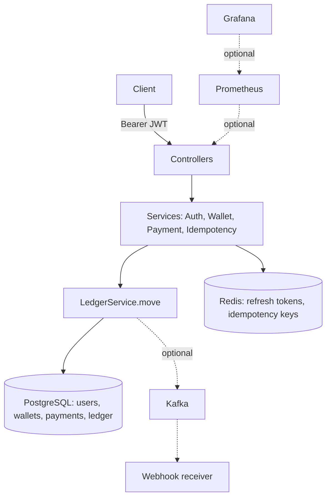
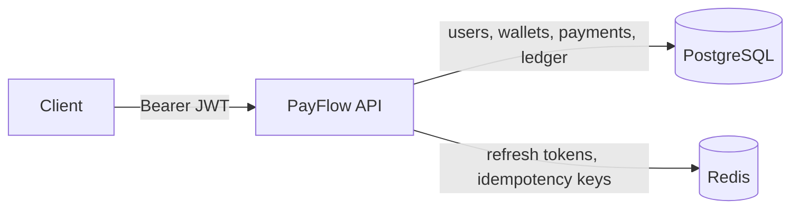

# PayFlow — Java/Spring Boot Payments Project Plan

*Nov 11, 2026 · @Ketan*

PayFlow is a digital wallet and payments backend built with Java 21 and Spring Boot 4. Users sign up, add money to a wallet and pay each other. A retried payment never charges twice, and a double-entry ledger records every rupee.

Build it in the 13 steps below, in order. Each step says what you're building, gives the files, code and config, a prompt to hand Claude Code, and a checklist to confirm it works before you move on.

## Contents

- [What you're building](#what-youre-building)
- [Step 1: Install tools and create the project](#step-1-install-tools-and-create-the-project)
- [Step 2: Configuration and local infrastructure](#step-2-configuration-and-local-infrastructure)
- [Step 3: Database schema, entities and repositories](#step-3-database-schema-entities-and-repositories)
- [Step 4: Error handling and shared helpers](#step-4-error-handling-and-shared-helpers)
- [Step 5: Signup, login, refresh and logout with JWT](#step-5-signup-login-refresh-and-logout-with-jwt)
- [Step 6: Wallets, history and top-ups](#step-6-wallets-history-and-top-ups)
- [Step 7: Payments between users](#step-7-payments-between-users)
- [Step 8: Idempotent payments](#step-8-idempotent-payments)
- [Step 9: Automated tests](#step-9-automated-tests)
- [Step 10: Docker image and the full stack](#step-10-docker-image-and-the-full-stack)
- [Step 11: CI with GitHub Actions, and the README](#step-11-ci-with-github-actions-and-the-readme)
- [Step 12 (optional): Kafka webhooks with retries](#step-12-optional-kafka-webhooks-with-retries)
- [Step 13 (optional): Metrics with Prometheus and Grafana](#step-13-optional-metrics-with-prometheus-and-grafana)

---

## What you're building

A REST API with four core features and two optional ones. Two guarantees matter more than any single feature: **a retried request never moves money twice**, and **the ledger always balances**.

### Features

| Feature | What a user can do | Step |
|---|---|---|
| Accounts | Sign up, log in, refresh a session, log out | 5 |
| Wallet | See their balance and transaction history | 6 |
| Top-up | Add money to their wallet | 6 |
| Payments | Send money to another user's wallet | 7 |
| Safe retries | Retry any top-up or payment without being charged twice | 8 |
| Webhooks (optional) | The receiver gets a signed notification for each payment | 12 |
| Metrics (optional) | Watch payment rates and latency on a dashboard | 13 |

### How one payment flows through the system

1. The client sends `POST /payments` with a Bearer access token and an `Idempotency-Key` header.
2. Spring Security's filter checks the JWT's signature, issuer and expiry. The controller reads the user id from the token, never from the request body.
3. `IdempotencyService` claims the key in Redis. A duplicate request gets the stored response back instead of running again.
4. `LedgerService` opens a database transaction: it locks both wallets, debits the sender (rejecting it if funds are short), credits the receiver, and writes one payment row and two ledger rows.
5. The transaction commits, the response is saved under the idempotency key, and the client gets `201 Created`. In Step 12 a `payment.completed` event also goes to Kafka after the commit.

### Tech stack

| Layer | Choice | Why |
|---|---|---|
| Language | Java 21 | Long-term support release, records for DTOs |
| Framework | Spring Boot 4 (Spring Security 7, Spring Data JPA) | Current stable Spring line |
| Database | PostgreSQL 16 with Flyway migrations | Transactions, row locks, versioned schema |
| Key store | Redis 7 | Atomic `SET NX` for idempotency, TTLs for refresh tokens |
| Auth | Spring Security OAuth2 Resource Server (Nimbus) | RS256 JWT signing and checking with no extra library |
| Tests | JUnit 5 and Testcontainers | Real Postgres and Redis in every test run |
| Packaging | Docker and Docker Compose | The whole system starts with one command |
| CI | GitHub Actions | Tests and image build on every push |
| Optional | Kafka, Prometheus, Grafana | Events, webhooks and dashboards |

### API you'll end up with

| Method and path | Auth | Body | Success | Main errors |
|---|---|---|---|---|
| `POST /auth/signup` | None | `email`, `password` | 201: user id, wallet id | 400, 409 email taken |
| `POST /auth/login` | None | `email`, `password` | 200: access token, refresh token, expires in | 401 |
| `POST /auth/refresh` | None | `refreshToken` | 200: new token pair | 401 |
| `POST /auth/logout` | Bearer | `refreshToken` | 204 | 401 |
| `GET /wallets/me` | Bearer | – | 200: wallet id, balance, currency | 401 |
| `GET /wallets/me/transactions?page=0&size=20` | Bearer | – | 200: ledger entries, newest first | 401 |
| `POST /wallets/me/topup` | Bearer + `Idempotency-Key` | `amount` | 201: payment | 400, 409, 422 |
| `POST /payments` | Bearer + `Idempotency-Key` | `toWalletId`, `amount`, `note` | 201: payment | 400, 404, 409, 422 |
| `GET /payments/{id}` | Bearer | – | 200: payment | 404 |

All amounts are integer paise: `"amount": 25000` means Rs 250.00.

### Schedule

| Day | Steps | Result at the end of the day |
|---|---|---|
| 1 | 1 to 5 | App boots against Postgres and Redis; signup and login return JWTs |
| 2 | 6 to 9 | Wallets, top-ups and idempotent payments work; all tests pass |
| 3 | 10 and 11, then 12 and 13 if time allows | One command starts everything; CI is green; README is done |

> **Working with Claude Code:** give it one step's prompt at a time, read the code it writes, run the step's checklist, and commit before moving on. If something breaks, paste the error and ask it to fix that one thing.

### Architecture

Requests flow top to bottom through the app. PostgreSQL holds the money and the ledger; Redis holds only short-lived keys, so losing Redis never loses money.



---

## Step 1: Install tools and create the project

You end this step with an empty Spring Boot 4 project that compiles and lives on GitHub.

### 1.1 Install

- **JDK 21** (Eclipse Temurin). Check with `java -version`.
- **Docker Desktop.** Check with `docker compose version`. Keep it running; later steps and all tests need it.
- **Git** and a GitHub account. The GitHub CLI (`gh`) is optional but handy.
- **IntelliJ IDEA Community**, or **VS Code** with the Extension Pack for Java.
- **Claude Code, curl, jq and openssl.**

You don't need to install Maven: the project ships with the `./mvnw` wrapper.

### 1.2 Generate the project at start.spring.io

- **Project:** Maven · **Language:** Java · **Spring Boot:** the latest stable 4.x it offers · **Java:** 21 · **Packaging:** Jar
- **Group:** `com.ketan` · **Artifact:** `payflow` · **Package name:** `com.ketan.payflow`
- **Dependencies:** Spring Web, Spring Security, OAuth2 Resource Server, Spring Data JPA, PostgreSQL Driver, Flyway Migration, Spring Data Redis (Access+Driver), Validation, Spring Boot Actuator, Prometheus, Lombok, Testcontainers

Click **Generate** and unzip it.

Don't hand-write the pom: Boot 4 split several starters into separate modules, and Initializr picks the right ones. OAuth2 Resource Server is what gives you Spring Security's built-in JWT support, so you need no third-party JWT library.

### 1.3 Package layout (by feature)

```text
src/main/java/com/ketan/payflow/
├── PayflowApplication.java
├── config/        SecurityConfig, JwtProperties, IdempotencyProperties, PaymentProperties
├── common/        ApiException + subclasses, GlobalExceptionHandler, CurrentUser, Hashing, PageResponse
├── user/          User, UserRepository
├── auth/          AuthController, AuthService, TokenService, RefreshTokenStore, dto/
├── wallet/        Wallet, WalletKind, WalletRepository, WalletService, WalletController, dto/
├── ledger/        LedgerEntry, Direction, LedgerEntryRepository, LedgerService, MoveCommand
├── payment/       Payment, PaymentType, PaymentRepository, PaymentService, PaymentController, dto/
└── idempotency/   IdempotencyService, IdempotencyRecord
src/main/resources/
├── application.yml
└── db/migration/V1__init.sql
src/test/java/com/ketan/payflow/   integration tests
src/test/resources/test-keys/      test-only RSA key pair (safe to commit)
keys/                              your real RSA key pair (never committed)
```

Packaging by feature keeps everything about payments in one folder, which is easier to navigate than separate controller, service and repository folders.

### 1.4 Add to `.gitignore`

```gitignore
target/
keys/
.env
.idea/
*.iml
```

### 1.5 Push to GitHub

```bash
cd payflow
git init
git add .
git commit -m "Initial Spring Boot 4 project"
gh repo create payflow --public --source=. --push   # or create the repo on github.com and push
```

### ✅ Check it works

- [ ] `./mvnw -q compile` finishes with no errors
- [ ] The repo is visible on GitHub with the generated files
- [ ] You have not run the app yet: it needs the database from Step 2

---

## Step 2: Configuration and local infrastructure

You end this step with Postgres and Redis running in Docker, signing keys on disk, and the app booting against them. Every host and secret is an environment variable with a local default, so the same config works on your laptop and in Docker later.

### 2.1 Generate the RSA key pairs

The private key signs JWTs; the public key checks them.

```bash
# Real keys for running the app (gitignored)
mkdir -p keys
openssl genpkey -algorithm RSA -pkeyopt rsa_keygen_bits:2048 -out keys/private.pem
openssl rsa -in keys/private.pem -pubout -out keys/public.pem

# Test-only keys, committed so tests and CI can sign tokens
mkdir -p src/test/resources/test-keys
openssl genpkey -algorithm RSA -pkeyopt rsa_keygen_bits:2048 -out src/test/resources/test-keys/private.pem
openssl rsa -in src/test/resources/test-keys/private.pem -pubout -out src/test/resources/test-keys/public.pem
```

> ⚠️ Never commit `keys/private.pem`: anyone holding it can mint a valid token for any user.

### 2.2 `docker-compose.yml` (infrastructure only for now)

```yaml
services:
  postgres:
    image: postgres:16
    environment:
      POSTGRES_DB: payflow
      POSTGRES_USER: payflow
      POSTGRES_PASSWORD: payflow
    ports: ["5432:5432"]
    volumes: ["pgdata:/var/lib/postgresql/data"]
    healthcheck:
      test: ["CMD-SHELL", "pg_isready -U payflow"]
      interval: 5s
      retries: 10

  redis:
    image: redis:7
    ports: ["6379:6379"]
    healthcheck:
      test: ["CMD", "redis-cli", "ping"]
      interval: 5s
      retries: 10

volumes:
  pgdata:
```

### 2.3 `src/main/resources/application.yml`

```yaml
spring:
  application:
    name: payflow
  datasource:
    url: ${DB_URL:jdbc:postgresql://localhost:5432/payflow}
    username: ${DB_USER:payflow}
    password: ${DB_PASSWORD:payflow}
  jpa:
    hibernate:
      ddl-auto: validate   # Flyway owns the schema; Hibernate only checks it matches
    open-in-view: false
  flyway:
    enabled: true
  data:
    redis:
      host: ${REDIS_HOST:localhost}
      port: 6379
  mvc:
    problemdetails:
      enabled: true

server:
  port: 8080

app:
  jwt:
    issuer: payflow
    access-token-ttl: 15m
    refresh-token-ttl: 7d
    private-key: ${JWT_PRIVATE_KEY:file:keys/private.pem}
    public-key: ${JWT_PUBLIC_KEY:file:keys/public.pem}
  idempotency:
    in-progress-ttl: 60s
    completed-ttl: 24h
  payments:
    max-amount: 10000000   # paise = Rs 1,00,000 per payment

management:
  endpoints:
    web:
      exposure:
        include: health, info, prometheus
  metrics:
    distribution:
      percentiles-histogram:
        http.server.requests: true
```

### 2.4 `src/test/resources/application.yml` (test overrides)

```yaml
app:
  jwt:
    private-key: classpath:test-keys/private.pem
    public-key: classpath:test-keys/public.pem
```

### 2.5 Typed config classes (package `config`)

```java
@ConfigurationProperties(prefix = "app.jwt")
public record JwtProperties(
        String issuer,
        Duration accessTokenTtl,
        Duration refreshTokenTtl,
        RSAPrivateKey privateKey,   // Spring Security converts the PEM file into a key object
        RSAPublicKey publicKey) {}

@ConfigurationProperties(prefix = "app.idempotency")
public record IdempotencyProperties(Duration inProgressTtl, Duration completedTtl) {}

@ConfigurationProperties(prefix = "app.payments")
public record PaymentProperties(long maxAmount) {}
```

Add `@ConfigurationPropertiesScan` to `PayflowApplication` so all three are picked up.

### 2.6 Environment variables

| Variable | Local default | Inside Docker (Step 10) |
|---|---|---|
| `DB_URL` | `jdbc:postgresql://localhost:5432/payflow` | `jdbc:postgresql://postgres:5432/payflow` |
| `DB_USER` / `DB_PASSWORD` | `payflow` / `payflow` | `payflow` / `payflow` |
| `REDIS_HOST` | `localhost` | `redis` |
| `JWT_PRIVATE_KEY` | `file:keys/private.pem` | `file:/keys/private.pem` |
| `JWT_PUBLIC_KEY` | `file:keys/public.pem` | `file:/keys/public.pem` |

> **Boot 4 notes**
> - Boot 4 uses Jackson 3, whose packages start with `tools.jackson`, not `com.fasterxml.jackson`. If Claude Code writes old imports, ask it to switch.
> - If a class name in this plan doesn't resolve on your exact Boot version, trust the compiler error and the generated pom, and ask Claude Code to adapt it.

### 🤖 Prompt for Claude Code

> Add docker-compose.yml with Postgres 16 and Redis 7 with healthchecks, exactly as in this plan. Replace application.yml with the one in the plan and add src/test/resources/application.yml pointing at test-keys. Create JwtProperties, IdempotencyProperties and PaymentProperties as records in the config package and add @ConfigurationPropertiesScan to the main class.

### ✅ Check it works

- [ ] `docker compose up -d`, then `docker compose ps` shows both containers as healthy
- [ ] `./mvnw spring-boot:run` logs "Started PayflowApplication"
- [ ] The log also shows a generated security password, and `curl -i localhost:8080/actuator/health` returns 401: both are expected until Step 5 adds your own security config
- [ ] `git status` does not list `keys/`

---

## Step 3: Database schema, entities and repositories

You end this step with four tables created by Flyway and mapped to JPA entities. All money is stored as `BIGINT` paise. A single SYSTEM wallet is the other side of every top-up, so top-ups also follow double-entry rules and all balances always add up to zero.

### 3.1 `src/main/resources/db/migration/V1__init.sql`

```sql
CREATE TABLE users (
    id            UUID PRIMARY KEY,
    email         VARCHAR(255) NOT NULL UNIQUE,
    password_hash VARCHAR(100) NOT NULL,
    created_at    TIMESTAMPTZ  NOT NULL DEFAULT now()
);

CREATE TABLE wallets (
    id         UUID PRIMARY KEY,
    user_id    UUID UNIQUE REFERENCES users(id),        -- NULL only for the SYSTEM wallet
    kind       VARCHAR(10) NOT NULL DEFAULT 'USER',     -- USER | SYSTEM
    balance    BIGINT      NOT NULL DEFAULT 0,          -- paise
    currency   VARCHAR(3)  NOT NULL DEFAULT 'INR',
    updated_at TIMESTAMPTZ NOT NULL DEFAULT now(),
    CONSTRAINT user_balance_not_negative CHECK (kind = 'SYSTEM' OR balance >= 0)
);

CREATE TABLE payments (
    id              UUID PRIMARY KEY,
    type            VARCHAR(10)  NOT NULL,              -- TOPUP | TRANSFER
    from_wallet_id  UUID         NOT NULL REFERENCES wallets(id),
    to_wallet_id    UUID         NOT NULL REFERENCES wallets(id),
    amount          BIGINT       NOT NULL CHECK (amount > 0),
    status          VARCHAR(10)  NOT NULL,              -- COMPLETED
    note            VARCHAR(140),
    created_by      UUID         NOT NULL REFERENCES users(id),
    idempotency_key VARCHAR(100) NOT NULL,
    created_at      TIMESTAMPTZ  NOT NULL DEFAULT now(),
    CONSTRAINT one_payment_per_key UNIQUE (created_by, idempotency_key),
    CONSTRAINT no_self_payment CHECK (from_wallet_id <> to_wallet_id)
);

CREATE TABLE ledger_entries (
    id         UUID PRIMARY KEY,
    payment_id UUID        NOT NULL REFERENCES payments(id),
    wallet_id  UUID        NOT NULL REFERENCES wallets(id),
    direction  VARCHAR(6)  NOT NULL CHECK (direction IN ('DEBIT', 'CREDIT')),
    amount     BIGINT      NOT NULL CHECK (amount > 0),
    created_at TIMESTAMPTZ NOT NULL DEFAULT now()
);

CREATE INDEX idx_ledger_wallet_time  ON ledger_entries (wallet_id, created_at DESC);
CREATE INDEX idx_payments_from_time  ON payments (from_wallet_id, created_at DESC);

-- The SYSTEM wallet funds every top-up; its balance goes negative by design
INSERT INTO wallets (id, kind) VALUES ('00000000-0000-0000-0000-000000000001', 'SYSTEM');
```

> Use `VARCHAR`, not `CHAR`, for text columns: Hibernate's `validate` mode rejects a `CHAR` column mapped to a Java `String`.

### 3.2 Entities

Rules for all four: UUID ids generated in Java, enums stored as strings, `long` for money, no public setters, and a static factory method to create new rows.

```java
@Entity
@Table(name = "users")
@Getter
@NoArgsConstructor(access = AccessLevel.PROTECTED)
public class User {
    @Id
    private UUID id;
    private String email;
    private String passwordHash;
    private Instant createdAt;

    public static User create(String email, String passwordHash) {
        User u = new User();
        u.id = UUID.randomUUID();
        u.email = email;
        u.passwordHash = passwordHash;
        u.createdAt = Instant.now();
        return u;
    }
}
```

```java
@Entity
@Table(name = "wallets")
@Getter
@NoArgsConstructor(access = AccessLevel.PROTECTED)
public class Wallet {
    public static final UUID SYSTEM_WALLET_ID = UUID.fromString("00000000-0000-0000-0000-000000000001");

    @Id
    private UUID id;
    private UUID userId;              // null for the SYSTEM wallet
    @Enumerated(EnumType.STRING)
    private WalletKind kind;          // USER or SYSTEM
    private long balance;             // paise
    private String currency;
    private Instant updatedAt;

    public static Wallet forUser(UUID userId) {
        Wallet w = new Wallet();
        w.id = UUID.randomUUID();
        w.userId = userId;
        w.kind = WalletKind.USER;
        w.currency = "INR";
        w.updatedAt = Instant.now();
        return w;
    }

    // credit() and debit() are added in Step 6
}
```

```java
@Entity
@Table(name = "ledger_entries")
@Getter
@NoArgsConstructor(access = AccessLevel.PROTECTED)
public class LedgerEntry {
    @Id
    private UUID id;
    private UUID paymentId;
    private UUID walletId;
    @Enumerated(EnumType.STRING)
    private Direction direction;      // DEBIT or CREDIT
    private long amount;
    private Instant createdAt;

    public static LedgerEntry debit(UUID paymentId, UUID walletId, long amount) {
        return of(paymentId, walletId, Direction.DEBIT, amount);
    }

    public static LedgerEntry credit(UUID paymentId, UUID walletId, long amount) {
        return of(paymentId, walletId, Direction.CREDIT, amount);
    }

    private static LedgerEntry of(UUID paymentId, UUID walletId, Direction direction, long amount) {
        LedgerEntry e = new LedgerEntry();
        e.id = UUID.randomUUID();
        e.paymentId = paymentId;
        e.walletId = walletId;
        e.direction = direction;
        e.amount = amount;
        e.createdAt = Instant.now();
        return e;
    }
}
```

`Payment` follows the same pattern with the fields `id`, `type` (enum `PaymentType`: TOPUP, TRANSFER), `fromWalletId`, `toWalletId`, `amount`, `status` (enum `PaymentStatus`: COMPLETED), `note`, `createdBy`, `idempotencyKey` and `createdAt`. Its factory method is added in Step 6. Spring Boot maps camelCase fields to snake_case columns, so you don't need `@Column` annotations.

### 3.3 Repositories

```java
public interface UserRepository extends JpaRepository<User, UUID> {
    Optional<User> findByEmail(String email);
    boolean existsByEmail(String email);
}

public interface WalletRepository extends JpaRepository<Wallet, UUID> {
    Optional<Wallet> findByUserId(UUID userId);

    @Lock(LockModeType.PESSIMISTIC_WRITE)   // SELECT ... FOR UPDATE
    @Query("select w from Wallet w where w.id = :id")
    Optional<Wallet> findByIdForUpdate(@Param("id") UUID id);
}

public interface PaymentRepository extends JpaRepository<Payment, UUID> {
    Optional<Payment> findByCreatedByAndIdempotencyKey(UUID createdBy, String idempotencyKey);
}

public interface LedgerEntryRepository extends JpaRepository<LedgerEntry, UUID> {
    Page<LedgerEntry> findByWalletIdOrderByCreatedAtDesc(UUID walletId, Pageable pageable);
}
```

### 3.4 The three rules the ledger must always obey

1. Every payment has exactly one DEBIT and one CREDIT entry of the same amount.
2. A wallet's balance equals its credits minus its debits.
3. The balances of all wallets, SYSTEM included, add up to 0.

Save these queries; you'll run them after Steps 6 and 7, and the tests in Step 9 run them automatically.

```sql
-- Rule 2: expect zero rows
SELECT w.id, w.balance
FROM wallets w
LEFT JOIN ledger_entries l ON l.wallet_id = w.id
GROUP BY w.id, w.balance
HAVING w.balance <> COALESCE(SUM(CASE l.direction WHEN 'CREDIT' THEN l.amount ELSE -l.amount END), 0);

-- Rule 3: expect 0
SELECT SUM(balance) FROM wallets;
```

### 🤖 Prompt for Claude Code

> Add the Flyway migration V1__init.sql exactly as written in the plan. Create JPA entities User, Wallet, Payment and LedgerEntry in their feature packages, with UUID ids set in Java, enums WalletKind, Direction, PaymentType and PaymentStatus stored as strings, long amounts, Lombok @Getter, protected no-arg constructors and the static factory methods shown. Add the four repositories exactly as shown.

### ✅ Check it works

- [ ] `./mvnw spring-boot:run` starts. Because `ddl-auto` is `validate`, a clean start proves the entities match the tables.
- [ ] `docker compose exec postgres psql -U payflow -c '\dt'` lists `users`, `wallets`, `payments`, `ledger_entries` and `flyway_schema_history`
- [ ] `docker compose exec postgres psql -U payflow -c 'select id, kind from wallets'` shows the SYSTEM wallet

---

## Step 4: Error handling and shared helpers

You end this step with one place that turns every error into a clean Problem Details (RFC 9457) JSON response, plus three small helpers the later steps use. Doing this before the features means every check from Step 5 on shows the right status code instead of a generic 500.

### 4.1 A base exception that knows its HTTP status

```java
public abstract class ApiException extends RuntimeException {
    private final HttpStatus status;
    private final String type;    // slug, e.g. "insufficient-funds"
    private final String title;   // short human-readable title

    protected ApiException(HttpStatus status, String type, String title, String detail) {
        super(detail);
        this.status = status;
        this.type = type;
        this.title = title;
    }

    public HttpStatus status() { return status; }

    public ProblemDetail toProblem(String path) {
        ProblemDetail pd = ProblemDetail.forStatusAndDetail(status, getMessage());
        pd.setType(URI.create("/errors/" + type));
        pd.setTitle(title);
        pd.setInstance(URI.create(path));
        return pd;
    }
}
```

Each error is a tiny subclass, for example:

```java
public class InsufficientFundsException extends ApiException {
    public InsufficientFundsException(long balance, long amount) {
        super(HttpStatus.UNPROCESSABLE_ENTITY, "insufficient-funds", "Insufficient funds",
              "Balance " + balance + " is less than amount " + amount);
    }
}
```

### 4.2 All the exceptions you'll need

| Exception | Status | Type slug | Thrown when |
|---|---|---|---|
| `InvalidCredentialsException` | 401 | `invalid-credentials` | Wrong email or password, or a bad refresh token |
| `EmailTakenException` | 409 | `email-taken` | Signup with an email that already exists |
| `WalletNotFoundException` | 404 | `wallet-not-found` | The caller has no wallet (should never happen) |
| `RecipientNotFoundException` | 404 | `recipient-not-found` | `toWalletId` doesn't exist or isn't a user wallet |
| `PaymentNotFoundException` | 404 | `payment-not-found` | Payment doesn't exist or the caller isn't part of it |
| `SelfPaymentException` | 400 | `self-payment` | Paying your own wallet |
| `AmountTooLargeException` | 422 | `amount-too-large` | Amount above `app.payments.max-amount` |
| `InsufficientFundsException` | 422 | `insufficient-funds` | Sender's balance is below the amount |
| `InvalidIdempotencyKeyException` | 400 | `invalid-idempotency-key` | Key blank or longer than 100 characters |
| `RequestInProgressException` | 409 | `request-in-progress` | Same key is still being processed |
| `IdempotencyKeyReusedException` | 422 | `idempotency-key-reused` | Same key sent with a different request body |

> Return 404, not 403, for someone else's payment so the API never confirms that a payment id exists.

### 4.3 `GlobalExceptionHandler` (package `common`)

```java
@Slf4j
@RestControllerAdvice
class GlobalExceptionHandler extends ResponseEntityExceptionHandler {

    @ExceptionHandler(ApiException.class)
    ResponseEntity<ProblemDetail> handleApi(ApiException ex, HttpServletRequest request) {
        return ResponseEntity.status(ex.status()).body(ex.toProblem(request.getRequestURI()));
    }

    @ExceptionHandler(Exception.class)
    ResponseEntity<ProblemDetail> handleUnexpected(Exception ex, HttpServletRequest request) {
        log.error("Unhandled error on {}", request.getRequestURI(), ex);   // full stack trace in logs only
        ProblemDetail pd = ProblemDetail.forStatusAndDetail(
                HttpStatus.INTERNAL_SERVER_ERROR, "Something went wrong");
        pd.setInstance(URI.create(request.getRequestURI()));
        return ResponseEntity.internalServerError().body(pd);
    }
}
```

Extending `ResponseEntityExceptionHandler` gives you Problem Details for free for bean-validation failures (400) and a missing `Idempotency-Key` header (400). Missing or invalid tokens are rejected earlier by the security filter with a 401 and an empty body; that's expected.

Example response body:

```json
{
  "type": "/errors/insufficient-funds",
  "title": "Insufficient funds",
  "status": 422,
  "detail": "Balance 1200 is less than amount 5000",
  "instance": "/payments"
}
```

### 4.4 Shared helpers (package `common`)

```java
public final class CurrentUser {
    // The user id always comes from the verified token, never from the request body
    public static UUID id(Jwt jwt) {
        return UUID.fromString(jwt.getSubject());
    }
}
```

```java
public final class Hashing {
    public static String sha256Hex(String value) {
        try {
            byte[] digest = MessageDigest.getInstance("SHA-256")
                    .digest(value.getBytes(StandardCharsets.UTF_8));
            return HexFormat.of().formatHex(digest);
        } catch (NoSuchAlgorithmException e) {
            throw new IllegalStateException(e);
        }
    }
    // hmacSha256Hex(secret, value) is added in Step 12
}
```

```java
public record PageResponse<T>(List<T> items, int page, int size, long totalItems) {
    public static <T> PageResponse<T> from(Page<T> p) {
        return new PageResponse<>(p.getContent(), p.getNumber(), p.getSize(), p.getTotalElements());
    }
}
```

`PageResponse` exists because Spring Data warns against returning its `Page` object straight from a controller: the JSON shape isn't stable.

### 🤖 Prompt for Claude Code

> In the common package, create the abstract ApiException exactly as in the plan, one subclass for each row of the exceptions table with the listed status, slug and title, GlobalExceptionHandler extending ResponseEntityExceptionHandler, and the helpers CurrentUser, Hashing and PageResponse. Use HttpStatus 422 for the unprocessable cases.

### ✅ Check it works

- [ ] `./mvnw -q compile` passes
- [ ] You'll see these responses for real from Step 5 on; for example, signup with an invalid email returns 400 with a Problem Details body

---

## Step 5: Signup, login, refresh and logout with JWT

You end this step with working accounts. Login returns a short-lived RS256 access token, which the server can check without a database lookup, and a long-lived refresh token kept in Redis so it can be rotated and revoked.

### 5.1 Token design

| Token | Format | Lifetime | Stored | Sent as |
|---|---|---|---|---|
| Access | JWT signed with RS256. Claims: `iss`, `sub` (user id), `email`, `iat`, `exp`, `jti` | 15 min | Nowhere | `Authorization: Bearer <token>` header |
| Refresh | 32 random bytes, Base64URL | 7 days | Redis key `refresh:<sha256 of token>` holding the user id | JSON body to `/auth/refresh` and `/auth/logout` |

Only the SHA-256 hash of a refresh token goes into Redis, so a leaked Redis dump can't be used to log in.

### 5.2 `SecurityConfig` (package `config`)

```java
@Configuration
@EnableWebSecurity
public class SecurityConfig {

    @Bean
    SecurityFilterChain api(HttpSecurity http) throws Exception {
        return http
                .csrf(csrf -> csrf.disable())   // stateless API with bearer tokens, no cookies to protect
                .sessionManagement(s -> s.sessionCreationPolicy(SessionCreationPolicy.STATELESS))
                .authorizeHttpRequests(a -> a
                        .requestMatchers("/auth/signup", "/auth/login", "/auth/refresh").permitAll()
                        .requestMatchers("/actuator/health/**", "/actuator/prometheus", "/error").permitAll()
                        .anyRequest().authenticated())
                .oauth2ResourceServer(o -> o.jwt(Customizer.withDefaults()))
                .build();
    }

    @Bean
    JwtDecoder jwtDecoder(JwtProperties props) {
        NimbusJwtDecoder decoder = NimbusJwtDecoder.withPublicKey(props.publicKey()).build();
        decoder.setJwtValidator(JwtValidators.createDefaultWithIssuer(props.issuer()));   // checks exp and iss
        return decoder;
    }

    @Bean
    JwtEncoder jwtEncoder(JwtProperties props) {
        JWK jwk = new RSAKey.Builder(props.publicKey()).privateKey(props.privateKey()).build();
        return new NimbusJwtEncoder(new ImmutableJWKSet<>(new JWKSet(jwk)));
    }

    @Bean
    PasswordEncoder passwordEncoder() {
        return new BCryptPasswordEncoder();
    }
}
```

### 5.3 `TokenService` (package `auth`)

```java
@Service
@RequiredArgsConstructor
public class TokenService {
    private final JwtEncoder encoder;
    private final JwtProperties props;
    private final SecureRandom random = new SecureRandom();

    public String issueAccessToken(User user) {
        Instant now = Instant.now();
        JwtClaimsSet claims = JwtClaimsSet.builder()
                .issuer(props.issuer())
                .subject(user.getId().toString())
                .claim("email", user.getEmail())
                .issuedAt(now)
                .expiresAt(now.plus(props.accessTokenTtl()))
                .id(UUID.randomUUID().toString())
                .build();
        JwsHeader header = JwsHeader.with(SignatureAlgorithm.RS256).build();
        return encoder.encode(JwtEncoderParameters.from(header, claims)).getTokenValue();
    }

    public String newRefreshToken() {
        byte[] bytes = new byte[32];
        random.nextBytes(bytes);
        return Base64.getUrlEncoder().withoutPadding().encodeToString(bytes);
    }
}
```

### 5.4 `RefreshTokenStore` (package `auth`)

```java
@Component
@RequiredArgsConstructor
public class RefreshTokenStore {
    private final StringRedisTemplate redis;
    private final JwtProperties props;

    public void save(String token, UUID userId) {
        redis.opsForValue().set(key(token), userId.toString(), props.refreshTokenTtl());
    }

    /** Returns the owner and deletes the token in one atomic GETDEL, so each token works once. */
    public Optional<UUID> consume(String token) {
        String userId = redis.opsForValue().getAndDelete(key(token));
        return Optional.ofNullable(userId).map(UUID::fromString);
    }

    public void revoke(String token) {
        redis.delete(key(token));
    }

    private String key(String token) {
        return "refresh:" + Hashing.sha256Hex(token);
    }
}
```

### 5.5 Request and response records (package `auth.dto`)

```java
public record SignupRequest(
        @NotBlank @Email String email,
        @NotBlank @Size(min = 8, max = 72) String password) {}   // BCrypt ignores bytes past 72

public record LoginRequest(@NotBlank String email, @NotBlank String password) {}

public record RefreshRequest(@NotBlank String refreshToken) {}

public record SignupResponse(UUID userId, UUID walletId) {}

public record TokenResponse(String accessToken, String refreshToken, long expiresIn) {}
```

### 5.6 `AuthService` (package `auth`)

```java
@Service
@RequiredArgsConstructor
public class AuthService {
    private final UserRepository users;
    private final WalletRepository wallets;
    private final PasswordEncoder passwordEncoder;
    private final TokenService tokens;
    private final RefreshTokenStore refreshTokens;
    private final JwtProperties props;

    @Transactional
    public SignupResponse signup(SignupRequest req) {
        String email = req.email().trim().toLowerCase();
        if (users.existsByEmail(email)) throw new EmailTakenException();
        User user = User.create(email, passwordEncoder.encode(req.password()));
        try {
            users.saveAndFlush(user);   // the UNIQUE constraint catches two signups racing
        } catch (DataIntegrityViolationException e) {
            throw new EmailTakenException();
        }
        Wallet wallet = wallets.save(Wallet.forUser(user.getId()));   // every user gets a wallet
        return new SignupResponse(user.getId(), wallet.getId());
    }

    public TokenResponse login(LoginRequest req) {
        User user = users.findByEmail(req.email().trim().toLowerCase())
                .filter(u -> passwordEncoder.matches(req.password(), u.getPasswordHash()))
                .orElseThrow(InvalidCredentialsException::new);   // same error for unknown email and wrong password
        return issueTokens(user);
    }

    public TokenResponse refresh(String refreshToken) {
        UUID userId = refreshTokens.consume(refreshToken).orElseThrow(InvalidCredentialsException::new);
        User user = users.findById(userId).orElseThrow(InvalidCredentialsException::new);
        return issueTokens(user);   // rotation: the old refresh token is already gone
    }

    public void logout(String refreshToken) {
        refreshTokens.revoke(refreshToken);
    }

    private TokenResponse issueTokens(User user) {
        String access = tokens.issueAccessToken(user);
        String refresh = tokens.newRefreshToken();
        refreshTokens.save(refresh, user.getId());
        return new TokenResponse(access, refresh, props.accessTokenTtl().toSeconds());
    }
}
```

### 5.7 `AuthController` (package `auth`)

```java
@RestController
@RequestMapping("/auth")
@RequiredArgsConstructor
class AuthController {
    private final AuthService auth;

    @PostMapping("/signup")
    @ResponseStatus(HttpStatus.CREATED)
    SignupResponse signup(@Valid @RequestBody SignupRequest req) {
        return auth.signup(req);
    }

    @PostMapping("/login")
    TokenResponse login(@Valid @RequestBody LoginRequest req) {
        return auth.login(req);
    }

    @PostMapping("/refresh")
    TokenResponse refresh(@Valid @RequestBody RefreshRequest req) {
        return auth.refresh(req.refreshToken());
    }

    @PostMapping("/logout")
    @ResponseStatus(HttpStatus.NO_CONTENT)
    void logout(@Valid @RequestBody RefreshRequest req) {
        auth.logout(req.refreshToken());
    }
}
```

In every later controller, read the caller with `@AuthenticationPrincipal Jwt jwt` and `CurrentUser.id(jwt)`.

### 🤖 Prompt for Claude Code

> Implement Step 5 of the plan: SecurityConfig, TokenService, RefreshTokenStore, the auth DTO records, AuthService and AuthController exactly as written. Signup creates the user and a USER wallet in one transaction. Logout requires a valid access token. Don't add any other endpoints.

### ✅ Check it works

```bash
curl -s -X POST localhost:8080/auth/signup -H 'Content-Type: application/json' \
  -d '{"email":"a@test.com","password":"password123"}'

curl -s -X POST localhost:8080/auth/login -H 'Content-Type: application/json' \
  -d '{"email":"a@test.com","password":"password123"}' | jq
```

- [ ] Signup returns 201 with a user id and wallet id; signing up again with the same email returns 409
- [ ] Signup with `"email":"nope"` returns 400 with a Problem Details body
- [ ] Login returns both tokens; a wrong password returns 401
- [ ] Pasting the access token into a JWT decoder shows `iss: payflow`, your user id in `sub`, and `exp` 15 minutes after `iat`
- [ ] Calling `/auth/refresh` with a refresh token works once; the same token a second time returns 401
- [ ] After `/auth/logout`, that refresh token returns 401
- [ ] `curl -i localhost:8080/actuator/health` now returns 200 without a token

---

## Step 6: Wallets, history and top-ups

You end this step with users able to see their balance and history and to add money. Here you also build `LedgerService.move()`, the one method that ever changes a balance. Top-ups use it now and payments reuse it in Step 7.

### 6.1 Give `Wallet` its money methods

```java
// inside Wallet
public void credit(long amount) {
    balance += amount;
    updatedAt = Instant.now();
}

public void debit(long amount) {
    if (kind == WalletKind.USER && balance < amount) {   // the SYSTEM wallet may go negative
        throw new InsufficientFundsException(balance, amount);
    }
    balance -= amount;
    updatedAt = Instant.now();
}
```

### 6.2 `MoveCommand` and the `Payment` factory

```java
// package ledger
public record MoveCommand(
        PaymentType type,
        UUID fromWalletId,
        UUID toWalletId,
        long amount,
        UUID createdBy,
        String idempotencyKey,
        String note) {}
```

```java
// inside Payment
public static Payment completed(MoveCommand cmd) {
    Payment p = new Payment();
    p.id = UUID.randomUUID();
    p.type = cmd.type();
    p.fromWalletId = cmd.fromWalletId();
    p.toWalletId = cmd.toWalletId();
    p.amount = cmd.amount();
    p.status = PaymentStatus.COMPLETED;
    p.note = cmd.note();
    p.createdBy = cmd.createdBy();
    p.idempotencyKey = cmd.idempotencyKey();
    p.createdAt = Instant.now();
    return p;
}
```

### 6.3 `LedgerService.move`: the heart of the system

```java
@Service
@RequiredArgsConstructor
public class LedgerService {
    private final WalletRepository wallets;
    private final PaymentRepository payments;
    private final LedgerEntryRepository entries;

    @Transactional
    public Payment move(MoveCommand cmd) {
        // 1. Lock both wallet rows, smaller id first. Two opposite transfers (A->B and B->A)
        //    then always lock in the same order and can never deadlock.
        UUID first  = cmd.fromWalletId().compareTo(cmd.toWalletId()) < 0 ? cmd.fromWalletId() : cmd.toWalletId();
        UUID second = first.equals(cmd.fromWalletId()) ? cmd.toWalletId() : cmd.fromWalletId();
        Wallet a = wallets.findByIdForUpdate(first).orElseThrow(WalletNotFoundException::new);
        Wallet b = wallets.findByIdForUpdate(second).orElseThrow(WalletNotFoundException::new);
        Wallet from = a.getId().equals(cmd.fromWalletId()) ? a : b;
        Wallet to   = (from == a) ? b : a;

        // 2. Move the money. debit() throws InsufficientFundsException, which rolls everything back.
        from.debit(cmd.amount());
        to.credit(cmd.amount());

        // 3. Record the payment and its two ledger entries
        Payment payment = payments.save(Payment.completed(cmd));
        entries.save(LedgerEntry.debit(payment.getId(), from.getId(), cmd.amount()));
        entries.save(LedgerEntry.credit(payment.getId(), to.getId(), cmd.amount()));

        // 4. The new balances are written at commit (JPA dirty checking)
        return payment;
    }
}
```

> **Rules for this method:** keep it short, never call another service over HTTP or Kafka inside it, and never change a balance anywhere else.

### 6.4 DTOs

```java
// package wallet.dto
public record TopUpRequest(@Positive long amount) {}

public record WalletResponse(UUID walletId, long balance, String currency) {
    public static WalletResponse from(Wallet w) {
        return new WalletResponse(w.getId(), w.getBalance(), w.getCurrency());
    }
}

public record LedgerEntryResponse(UUID paymentId, String direction, long amount, Instant createdAt) {
    public static LedgerEntryResponse from(LedgerEntry e) {
        return new LedgerEntryResponse(e.getPaymentId(), e.getDirection().name(), e.getAmount(), e.getCreatedAt());
    }
}
```

```java
// package payment.dto
public record PaymentResponse(UUID id, String type, UUID fromWalletId, UUID toWalletId,
                              long amount, String status, String note, Instant createdAt) {
    public static PaymentResponse from(Payment p) {
        return new PaymentResponse(p.getId(), p.getType().name(), p.getFromWalletId(), p.getToWalletId(),
                p.getAmount(), p.getStatus().name(), p.getNote(), p.getCreatedAt());
    }
}
```

### 6.5 `WalletService`

```java
@Service
@RequiredArgsConstructor
public class WalletService {
    private final WalletRepository wallets;
    private final LedgerEntryRepository entries;
    private final LedgerService ledger;
    private final PaymentProperties props;

    public WalletResponse get(UUID userId) {
        return WalletResponse.from(myWallet(userId));
    }

    public PageResponse<LedgerEntryResponse> history(UUID userId, int page, int size) {
        Pageable pageable = PageRequest.of(Math.max(page, 0), Math.clamp(size, 1, 100));
        return PageResponse.from(entries
                .findByWalletIdOrderByCreatedAtDesc(myWallet(userId).getId(), pageable)
                .map(LedgerEntryResponse::from));
    }

    public PaymentResponse topUp(UUID userId, long amount, String idempotencyKey) {
        if (amount > props.maxAmount()) throw new AmountTooLargeException(props.maxAmount());
        Wallet mine = myWallet(userId);
        Payment p = ledger.move(new MoveCommand(PaymentType.TOPUP, Wallet.SYSTEM_WALLET_ID, mine.getId(),
                amount, userId, idempotencyKey, "Top-up"));
        return PaymentResponse.from(p);
    }

    private Wallet myWallet(UUID userId) {
        return wallets.findByUserId(userId).orElseThrow(WalletNotFoundException::new);
    }
}
```

### 6.6 `WalletController`

```java
@RestController
@RequestMapping("/wallets/me")
@RequiredArgsConstructor
class WalletController {
    private final WalletService walletService;

    @GetMapping
    WalletResponse get(@AuthenticationPrincipal Jwt jwt) {
        return walletService.get(CurrentUser.id(jwt));
    }

    @GetMapping("/transactions")
    PageResponse<LedgerEntryResponse> history(@AuthenticationPrincipal Jwt jwt,
                                              @RequestParam(defaultValue = "0") int page,
                                              @RequestParam(defaultValue = "20") int size) {
        return walletService.history(CurrentUser.id(jwt), page, size);
    }

    @PostMapping("/topup")
    @ResponseStatus(HttpStatus.CREATED)
    PaymentResponse topUp(@AuthenticationPrincipal Jwt jwt,
                          @RequestHeader("Idempotency-Key") String idempotencyKey,
                          @Valid @RequestBody TopUpRequest req) {
        return walletService.topUp(CurrentUser.id(jwt), req.amount(), idempotencyKey);
    }
}
```

The `Idempotency-Key` header is required from now on and saved on the payment. Step 8 adds the Redis layer that makes retries safe.

### 🤖 Prompt for Claude Code

> Implement Step 6 of the plan: add credit() and debit() to Wallet, the MoveCommand record, Payment.completed(), LedgerService.move() exactly as written, the wallet and payment DTO records, WalletService and WalletController. LedgerService.move must be the only code that changes a wallet balance.

### ✅ Check it works

```bash
TOKEN=$(curl -s -X POST localhost:8080/auth/login -H 'Content-Type: application/json' \
  -d '{"email":"a@test.com","password":"password123"}' | jq -r .accessToken)

curl -s -X POST localhost:8080/wallets/me/topup -H "Authorization: Bearer $TOKEN" \
  -H 'Idempotency-Key: topup-1' -H 'Content-Type: application/json' -d '{"amount":50000}' | jq

curl -s localhost:8080/wallets/me -H "Authorization: Bearer $TOKEN" | jq
curl -s localhost:8080/wallets/me/transactions -H "Authorization: Bearer $TOKEN" | jq
```

- [ ] Top-up returns 201 with a TOPUP payment; the balance is now 50000
- [ ] History shows one CREDIT entry of 50000
- [ ] Both ledger queries from 3.4 pass: no rows, and the total is 0 (the SYSTEM wallet sits at -50000)
- [ ] A top-up without the `Idempotency-Key` header returns 400
- [ ] A top-up of 0 or a negative amount returns 400; above 10000000 returns 422

> Reusing `topup-1` currently fails with a 500 from the unique constraint. That's expected; Step 8 turns it into a safe replay.

---

## Step 7: Payments between users

You end this step with users paying each other, staying correct when many payments hit the same wallet at once. Most of the hard work already lives in `LedgerService.move()`; this step adds validation, the endpoints and proof that the locking works.

### 7.1 `PayRequest` (package `payment.dto`)

```java
public record PayRequest(
        @NotNull UUID toWalletId,
        @Positive long amount,
        @Size(max = 140) String note) {}
```

### 7.2 `PaymentService`

```java
@Service
@RequiredArgsConstructor
public class PaymentService {
    private final WalletRepository wallets;
    private final PaymentRepository payments;
    private final LedgerService ledger;
    private final PaymentProperties props;

    public PaymentResponse pay(UUID userId, PayRequest req, String idempotencyKey) {
        if (req.amount() > props.maxAmount()) throw new AmountTooLargeException(props.maxAmount());
        Wallet from = wallets.findByUserId(userId).orElseThrow(WalletNotFoundException::new);
        Wallet to = wallets.findById(req.toWalletId())
                .filter(w -> w.getKind() == WalletKind.USER)   // nobody can pay the SYSTEM wallet
                .orElseThrow(RecipientNotFoundException::new);
        if (from.getId().equals(to.getId())) throw new SelfPaymentException();

        Payment p = ledger.move(new MoveCommand(PaymentType.TRANSFER, from.getId(), to.getId(),
                req.amount(), userId, idempotencyKey, req.note()));
        return PaymentResponse.from(p);
    }

    public PaymentResponse get(UUID userId, UUID paymentId) {
        UUID mine = wallets.findByUserId(userId).orElseThrow(WalletNotFoundException::new).getId();
        return payments.findById(paymentId)
                .filter(p -> p.getFromWalletId().equals(mine) || p.getToWalletId().equals(mine))
                .map(PaymentResponse::from)
                .orElseThrow(PaymentNotFoundException::new);   // 404 for other people's payments too
    }
}
```

### 7.3 `PaymentController`

```java
@RestController
@RequestMapping("/payments")
@RequiredArgsConstructor
class PaymentController {
    private final PaymentService payments;

    @PostMapping
    @ResponseStatus(HttpStatus.CREATED)
    PaymentResponse pay(@AuthenticationPrincipal Jwt jwt,
                        @RequestHeader("Idempotency-Key") String idempotencyKey,
                        @Valid @RequestBody PayRequest req) {
        return payments.pay(CurrentUser.id(jwt), req, idempotencyKey);
    }

    @GetMapping("/{id}")
    PaymentResponse get(@AuthenticationPrincipal Jwt jwt, @PathVariable UUID id) {
        return payments.get(CurrentUser.id(jwt), id);
    }
}
```

### 7.4 Why this stays correct under concurrency

| Situation | Without row locks | With this design |
|---|---|---|
| Two Rs 80 payments leave a wallet holding Rs 100 at the same moment | Both read Rs 100, both pass the check, balance ends at -Rs 60 | The second waits for the row lock, then sees Rs 20 and is rejected with 422 |
| A pays B while B pays A | Each transaction locks one wallet and waits for the other: deadlock | Both lock the smaller wallet id first, so one simply waits its turn |
| A bug skips the balance check | The overdraft is saved | The database's `CHECK (balance >= 0)` rejects the commit |

**Why pessimistic locking (`SELECT ... FOR UPDATE`) instead of optimistic locking with a version column:** a busy wallet sending many payments would hit constant version conflicts and retries, while row locks simply queue them. Optimistic locking suits data where conflicts are rare.

### 🤖 Prompt for Claude Code

> Implement Step 7 of the plan: PayRequest, PaymentService and PaymentController exactly as written. pay() validates the amount limit, that the recipient is an existing USER wallet, and that it isn't the sender's own wallet, then calls LedgerService.move. get() returns 404 unless the caller's wallet is the sender or the receiver.

### ✅ Check it works

```bash
# Sign up B and C, note B's walletId, log in as C and top C up with exactly Rs 100
B_WALLET=<B's walletId>
C_TOKEN=<C's access token>

curl -s -X POST localhost:8080/wallets/me/topup -H "Authorization: Bearer $C_TOKEN" \
  -H 'Idempotency-Key: c-topup' -H 'Content-Type: application/json' -d '{"amount":10000}'

# Fire 20 payments of Rs 10 from C to B at the same moment
seq 1 20 | xargs -P 20 -I{} curl -s -o /dev/null -w "%{http_code}\n" -X POST localhost:8080/payments \
  -H "Authorization: Bearer $C_TOKEN" -H "Idempotency-Key: burst-{}" \
  -H 'Content-Type: application/json' -d "{\"toWalletId\":\"$B_WALLET\",\"amount\":1000}" \
  | sort | uniq -c
```

- [ ] A normal payment returns 201 and moves the money; both users see it in their history
- [ ] The burst prints exactly 10 `201` and 10 `422`, and C's balance is 0
- [ ] Paying your own wallet returns 400; paying a random UUID returns 404; paying more than you have returns 422 and nothing changes
- [ ] `GET /payments/{id}` works for the sender and receiver and returns 404 for a third user
- [ ] Both ledger queries from 3.4 still pass

---

## Step 8: Idempotent payments

You end this step with safe retries: a client that resends a top-up or payment with the same `Idempotency-Key` gets the original response back and is never charged twice. Redis handles the fast path, and the database's `one_payment_per_key` constraint is the backstop if Redis ever loses a key.

### 8.1 How it works

- **Redis key:** `idem:<userId>:<Idempotency-Key>`, scoped per user so two users' keys can't collide.
- **Value:** JSON with `state` (IN_PROGRESS or COMPLETED), `requestHash` (SHA-256 of the path plus the body), and the stored response `status` and `body`.
- **TTL:** 60 seconds while IN_PROGRESS, 24 hours once COMPLETED. The short first TTL means a crash mid-request doesn't block the key for a day.

Steps for every request:

1. Key blank or over 100 characters: 400.
2. `SET key IN_PROGRESS NX EX 60`. NX is atomic: if two identical requests arrive at the same instant, only one wins.
3. Won the key: run the action. On success, or on a business error (400, 404, 422), save it as COMPLETED for 24 hours and return it.
4. Unexpected error (500): delete the key so the client can retry safely.
5. Lost the key: answer from the table below.

| Stored record | Same request? | Response |
|---|---|---|
| IN_PROGRESS | Yes | 409 `request-in-progress`; the client retries shortly |
| COMPLETED | Yes | The stored status and body, plus header `Idempotent-Replayed: true` |
| Either state | No | 422 `idempotency-key-reused` |

### 8.2 `IdempotencyRecord`

```java
public record IdempotencyRecord(String state, String requestHash, int status, String body) {
    static IdempotencyRecord inProgress(String hash) {
        return new IdempotencyRecord("IN_PROGRESS", hash, 0, null);
    }

    static IdempotencyRecord completed(String hash, int status, String body) {
        return new IdempotencyRecord("COMPLETED", hash, status, body);
    }

    boolean isCompleted() {
        return "COMPLETED".equals(state);
    }
}
```

### 8.3 `IdempotencyService`

```java
@Service
@RequiredArgsConstructor
public class IdempotencyService {
    private final StringRedisTemplate redis;
    private final JsonMapper json;   // Jackson 3: tools.jackson.databind.json.JsonMapper
    private final IdempotencyProperties props;

    public ResponseEntity<?> execute(UUID userId, String key, String path, Object request,
                                     HttpStatus successStatus, Supplier<Object> action) {
        if (key == null || key.isBlank() || key.length() > 100) throw new InvalidIdempotencyKeyException();
        String redisKey = "idem:" + userId + ":" + key;
        String hash = Hashing.sha256Hex(path + json.writeValueAsString(request));

        Boolean claimed = redis.opsForValue().setIfAbsent(
                redisKey,
                json.writeValueAsString(IdempotencyRecord.inProgress(hash)),
                props.inProgressTtl());
        if (!Boolean.TRUE.equals(claimed)) {
            return replay(redisKey, hash);
        }

        try {
            Object body = action.get();
            save(redisKey, IdempotencyRecord.completed(hash, successStatus.value(), json.writeValueAsString(body)));
            return ResponseEntity.status(successStatus).body(body);
        } catch (ApiException e) {
            // A business error is a final answer: a retry must get the same answer
            save(redisKey, IdempotencyRecord.completed(hash, e.status().value(),
                    json.writeValueAsString(e.toProblem(path))));
            throw e;
        } catch (RuntimeException e) {
            redis.delete(redisKey);   // unexpected failure: allow a retry
            throw e;
        }
    }

    private ResponseEntity<?> replay(String redisKey, String hash) {
        String raw = redis.opsForValue().get(redisKey);
        if (raw == null) throw new RequestInProgressException();   // expired between our two calls
        IdempotencyRecord existing = json.readValue(raw, IdempotencyRecord.class);
        if (!existing.requestHash().equals(hash)) throw new IdempotencyKeyReusedException();
        if (!existing.isCompleted()) throw new RequestInProgressException();

        MediaType type = existing.status() >= 400 ? MediaType.APPLICATION_PROBLEM_JSON : MediaType.APPLICATION_JSON;
        return ResponseEntity.status(existing.status())
                .contentType(type)
                .header("Idempotent-Replayed", "true")
                .body(json.readTree(existing.body()));
    }

    private void save(String redisKey, IdempotencyRecord record) {
        redis.opsForValue().set(redisKey, json.writeValueAsString(record), props.completedTtl());
    }
}
```

### 8.4 Wrap the two money endpoints

```java
// PaymentController
@PostMapping
ResponseEntity<?> pay(@AuthenticationPrincipal Jwt jwt,
                      @RequestHeader("Idempotency-Key") String key,
                      @Valid @RequestBody PayRequest req,
                      HttpServletRequest http) {
    UUID userId = CurrentUser.id(jwt);
    return idempotency.execute(userId, key, http.getRequestURI(), req, HttpStatus.CREATED,
            () -> payments.pay(userId, req, key));
}
```

Do the same for `POST /wallets/me/topup` in `WalletController`, passing the `TopUpRequest`. Remove `@ResponseStatus(HttpStatus.CREATED)` from both methods, because the `ResponseEntity` now sets the status.

### 8.5 The database backstop

If Redis is flushed or restarts, the retry reaches `LedgerService.move()` again and the `UNIQUE (created_by, idempotency_key)` constraint fails at commit, rolling the whole transaction back. Catch that and return the original payment instead. In `PaymentService.pay` (and the same in `WalletService.topUp`):

```java
try {
    Payment p = ledger.move(new MoveCommand(PaymentType.TRANSFER, from.getId(), to.getId(),
            req.amount(), userId, idempotencyKey, req.note()));
    return PaymentResponse.from(p);
} catch (DataIntegrityViolationException e) {
    // Redis lost the key but this payment already exists: return the original
    return payments.findByCreatedByAndIdempotencyKey(userId, idempotencyKey)
            .map(PaymentResponse::from)
            .orElseThrow(() -> e);   // some other constraint failed: rethrow
}
```

### 🤖 Prompt for Claude Code

> Implement Step 8 of the plan: IdempotencyRecord and IdempotencyService exactly as written, using Spring Boot 4's Jackson 3 JsonMapper. Wrap POST /payments and POST /wallets/me/topup with idempotency.execute(), and add the DataIntegrityViolationException backstop to PaymentService.pay and WalletService.topUp.

### ✅ Check it works

```bash
# Run this exact request twice
curl -si -X POST localhost:8080/payments -H "Authorization: Bearer $TOKEN" \
  -H 'Idempotency-Key: pay-1' -H 'Content-Type: application/json' \
  -d "{\"toWalletId\":\"$B_WALLET\",\"amount\":2500}"

docker compose exec redis redis-cli --scan --pattern 'idem:*'
docker compose exec redis redis-cli TTL "idem:<userId>:pay-1"
```

- [ ] The second response has the same payment id and the header `Idempotent-Replayed: true`; the balance moved only once
- [ ] Same key with `"amount":3000` returns 422 `idempotency-key-reused`
- [ ] A payment rejected for insufficient funds, retried with the same key, returns the same 422 with the replay header
- [ ] The Redis key exists with a TTL close to 86400 seconds
- [ ] After `docker compose exec redis redis-cli FLUSHALL`, log in again and repeat `pay-1`: you get the original payment back (database backstop) and the balance doesn't change

---

## Step 9: Automated tests

You end this step with integration tests that run against real Postgres and Redis in Testcontainers. They prove the locking, idempotency and ledger rules actually hold, not just that mocks were called. They call the API over real HTTP, so the concurrency tests hit real server threads.

### 9.1 Add Redis to the generated `TestcontainersConfiguration`

Initializr already generated `src/test/java/.../TestcontainersConfiguration.java` with a Postgres container. Add:

```java
@Bean
@ServiceConnection(name = "redis")
GenericContainer<?> redis() {
    return new GenericContainer<>("redis:7").withExposedPorts(6379);
}
```

`@ServiceConnection` wires the container's host and port into Spring automatically. Containers start once and are shared by every test that uses the same Spring context.

### 9.2 A base class with API helpers

```java
@SpringBootTest(webEnvironment = SpringBootTest.WebEnvironment.RANDOM_PORT)
@Import(TestcontainersConfiguration.class)
abstract class ApiTestBase {
    @LocalServerPort int port;
    @Autowired JdbcTemplate jdbc;
    RestClient http;

    record Account(String token, UUID walletId) {}

    @BeforeEach
    void setUpClient() {
        http = RestClient.builder()
                .baseUrl("http://localhost:" + port)
                .defaultStatusHandler(status -> true, (req, res) -> {})   // never throw; tests assert the status
                .build();
    }

    Account newAccount() {
        String email = UUID.randomUUID() + "@test.com";   // unique, so tests never clash
        Map<?, ?> signup = http.post().uri("/auth/signup").contentType(MediaType.APPLICATION_JSON)
                .body(Map.of("email", email, "password", "password123")).retrieve().body(Map.class);
        Map<?, ?> login = http.post().uri("/auth/login").contentType(MediaType.APPLICATION_JSON)
                .body(Map.of("email", email, "password", "password123")).retrieve().body(Map.class);
        return new Account((String) login.get("accessToken"), UUID.fromString((String) signup.get("walletId")));
    }

    int pay(Account from, UUID toWallet, long amount, String key) {
        return http.post().uri("/payments")
                .header("Authorization", "Bearer " + from.token())
                .header("Idempotency-Key", key)
                .contentType(MediaType.APPLICATION_JSON)
                .body(Map.of("toWalletId", toWallet, "amount", amount))
                .retrieve().toBodilessEntity().getStatusCode().value();
    }

    // topUp(account, amount, key) and balance(account) follow the same pattern

    @AfterEach
    void ledgerStillBalances() {   // checked after every single test
        assertThat(jdbc.queryForObject("SELECT SUM(balance) FROM wallets", Long.class)).isZero();
        Integer mismatched = jdbc.queryForObject("""
                SELECT COUNT(*) FROM (
                  SELECT w.id FROM wallets w LEFT JOIN ledger_entries l ON l.wallet_id = w.id
                  GROUP BY w.id, w.balance
                  HAVING w.balance <> COALESCE(SUM(CASE l.direction WHEN 'CREDIT' THEN l.amount ELSE -l.amount END), 0)
                ) bad""", Integer.class);
        assertThat(mismatched).isZero();
    }
}
```

### 9.3 The concurrency test, in full

```java
class PaymentConcurrencyTest extends ApiTestBase {

    @Test
    void twentyParallelPayments_neverOverdraw() throws Exception {
        Account a = newAccount();
        Account b = newAccount();
        topUp(a, 10_000, "topup-" + UUID.randomUUID());   // Rs 100

        ExecutorService pool = Executors.newFixedThreadPool(20);
        CountDownLatch start = new CountDownLatch(1);
        List<Future<Integer>> results = new ArrayList<>();
        for (int i = 0; i < 20; i++) {
            String key = "pay-" + i;
            results.add(pool.submit(() -> {
                start.await();                              // all 20 threads fire together
                return pay(a, b.walletId(), 1_000, key);    // Rs 10 each
            }));
        }
        start.countDown();

        List<Integer> statuses = new ArrayList<>();
        for (Future<Integer> f : results) statuses.add(f.get(30, TimeUnit.SECONDS));
        pool.shutdown();

        assertThat(statuses).filteredOn(s -> s == 201).hasSize(10);
        assertThat(statuses).filteredOn(s -> s == 422).hasSize(10);
        assertThat(balance(a)).isZero();
    }
}
```

### 9.4 All the tests to write

| Test class | Test | What it proves |
|---|---|---|
| `AuthTest` | `signupThenLogin_returnsTokens` | The auth happy path works end to end |
| `AuthTest` | `duplicateEmail_returns409` | Emails are unique |
| `AuthTest` | `noToken_returns401` | Protected endpoints are actually protected |
| `AuthTest` | `tamperedToken_returns401` | Changing one character of the signature breaks validation |
| `AuthTest` | `refresh_worksOnce` | A refresh token works once, then returns 401 |
| `AuthTest` | `logout_revokesRefreshToken` | Logout really revokes |
| `WalletTest` | `topUp_creditsWalletAndLedger` | Balance and history both show the top-up |
| `PaymentTest` | `transfer_movesMoney_twoLedgerEntries` | One DEBIT and one CREDIT of the same amount |
| `PaymentTest` | `insufficientFunds_returns422_nothingChanges` | The rollback leaves balances and ledger untouched |
| `PaymentTest` | `selfPayment_returns400` and `unknownRecipient_returns404` | Validation works |
| `PaymentTest` | `otherUsersPayment_returns404` | Payments stay private |
| `IdempotencyTest` | `samePaymentTwice_chargedOnce` | Same id comes back with `Idempotent-Replayed`; balance moves once |
| `IdempotencyTest` | `sameKeyDifferentBody_returns422` | A key can't be reused for a different payment |
| `IdempotencyTest` | `failedPaymentReplays422` | A rejected payment retried with the same key gets the same 422 |
| `IdempotencyTest` | `redisFlushed_dbBackstopReturnsOriginal` | Flush Redis with `RedisTemplate`, retry, get the original payment |
| `PaymentConcurrencyTest` | `twentyParallelPayments_neverOverdraw` | Exactly 10 succeed, 10 get 422, balance ends at 0 |
| `PaymentConcurrencyTest` | `crossTransfers_noDeadlock` | 50 rounds of A→B and B→A in parallel all finish within 30 s |

### 🤖 Prompt for Claude Code

> Implement Step 9 of the plan: add the Redis container to TestcontainersConfiguration, create ApiTestBase exactly as written with the missing topUp and balance helpers, and write every test in the table as integration tests extending ApiTestBase. Use AssertJ. Don't mock any of our own classes.

### ✅ Check it works

- [ ] With Docker running, `./mvnw verify` passes. The first run is slower while it pulls the images.
- [ ] Temporarily remove the `findByIdForUpdate` lock (use plain `findById`) and the concurrency test fails. Put the lock back: it passes. This proves the test really tests the locking.
- [ ] Commit the tests

---

## Step 10: Docker image and the full stack

You end this step with the whole system, app included, starting from a fresh clone with one command. The image is built in two stages so the final image holds only a JRE and your jar, and it runs as a non-root user.

### 10.1 `Dockerfile`

```dockerfile
# Stage 1: build the jar
FROM maven:3.9-eclipse-temurin-21 AS build
WORKDIR /app
COPY pom.xml .
RUN mvn -q dependency:go-offline        # cached layer: re-runs only when the pom changes
COPY src ./src
RUN mvn -q package -DskipTests          # tests run in CI, not in the image build

# Stage 2: run it
FROM eclipse-temurin:21-jre
WORKDIR /app
RUN useradd --system --uid 1001 payflow
COPY --from=build /app/target/*.jar app.jar
USER payflow
EXPOSE 8080
ENTRYPOINT ["java", "-jar", "app.jar"]
```

### 10.2 `.dockerignore`

```text
target/
keys/
.git/
.idea/
```

Keys are mounted at runtime and never baked into the image.

### 10.3 Final `docker-compose.yml`

```yaml
services:
  postgres:
    image: postgres:16
    environment:
      POSTGRES_DB: payflow
      POSTGRES_USER: payflow
      POSTGRES_PASSWORD: payflow
    ports: ["5432:5432"]
    volumes: ["pgdata:/var/lib/postgresql/data"]
    healthcheck:
      test: ["CMD-SHELL", "pg_isready -U payflow"]
      interval: 5s
      retries: 10

  redis:
    image: redis:7
    ports: ["6379:6379"]
    healthcheck:
      test: ["CMD", "redis-cli", "ping"]
      interval: 5s
      retries: 10

  app:
    build: .
    ports: ["8080:8080"]
    environment:
      DB_URL: jdbc:postgresql://postgres:5432/payflow
      DB_USER: payflow
      DB_PASSWORD: payflow
      REDIS_HOST: redis
      JWT_PRIVATE_KEY: file:/keys/private.pem
      JWT_PUBLIC_KEY: file:/keys/public.pem
    volumes:
      - ./keys:/keys:ro
    depends_on:
      postgres: { condition: service_healthy }
      redis: { condition: service_healthy }

volumes:
  pgdata:
```

> `openssl` creates `private.pem` readable only by your user, and the container runs as user 1001. For local Docker runs, make the keys readable with `chmod 644 keys/*.pem`. In a real deployment the key would come from a secrets manager instead.

### 10.4 Start from scratch

```bash
docker compose down -v          # stop the app in your IDE first; -v wipes local data
chmod 644 keys/*.pem
docker compose up --build -d
docker compose logs -f app      # wait for "Started PayflowApplication"
```

### 🤖 Prompt for Claude Code

> Add the two-stage Dockerfile and .dockerignore from Step 10 of the plan, and add the app service to docker-compose.yml exactly as written, with keys mounted read-only from ./keys.

### ✅ Check it works

- [ ] `docker compose up --build -d` starts three containers; `docker compose ps` shows all of them running
- [ ] `curl localhost:8080/actuator/health` returns `{"status":"UP"}`
- [ ] The curl checks from Steps 5 to 8 all pass against the containerised app
- [ ] `docker image ls` shows the payflow image well under the size of the Maven build image
- [ ] `docker compose exec app whoami` prints `payflow`, not `root`

---

## Step 11: CI with GitHub Actions, and the README

You end this step with every push tested and built automatically, and a README that lets anyone run the project and understand its design in five minutes.

### 11.1 `.github/workflows/ci.yml`

```yaml
name: ci

on:
  push:
  pull_request:

jobs:
  build:
    runs-on: ubuntu-latest
    steps:
      - uses: actions/checkout@v4
      - uses: actions/setup-java@v4
        with:
          distribution: temurin
          java-version: '21'
          cache: maven
      - name: Run tests
        run: ./mvnw -B verify
      - name: Build Docker image
        run: docker build -t payflow:${{ github.sha }} .
```

GitHub's Ubuntu runners come with Docker, so Testcontainers works there with no extra setup. The tests sign tokens with the committed test-only keys, so CI needs no secrets. If the job fails with "permission denied" on `./mvnw`, run `git update-index --chmod=+x mvnw` and push again.

### 11.2 README.md outline

1. **Title and CI badge.** Copy the badge markdown from the Actions tab ("Create status badge").
2. **What it is:** two lines. A wallet and payments API with JWT auth, idempotent payments and a double-entry ledger.
3. **Architecture:** the diagram below, plus one sentence on where money lives (Postgres) and what Redis holds (short-lived keys).
4. **Run it:** the three commands to generate keys, the `chmod`, and `docker compose up --build`.
5. **API:** the endpoint table from the top of this plan and the curl walkthrough from Steps 5 to 8.
6. **Design decisions,** one short paragraph each: RS256 JWT with rotating refresh tokens; idempotency keys in Redis with a database backstop; double-entry ledger with a SYSTEM wallet; row locks taken in a fixed order; money as integer paise.
7. **Testing:** `./mvnw verify`, what the concurrency and idempotency tests prove, and that a ledger check runs after every test.
8. **What I'd add next:** the transactional outbox for events, rate limiting on login, Kubernetes manifests.

A diagram GitHub renders natively; put this inside a `mermaid` code fence in the README:



### 🤖 Prompt for Claude Code

> Add .github/workflows/ci.yml exactly as in Step 11 of the plan. Then write README.md following the outline in 11.2, using a mermaid flowchart for the architecture, real curl examples that match our API, and a Design decisions section with one paragraph per decision.

### ✅ Check it works

- [ ] After pushing, the Actions tab shows a green run with both steps
- [ ] The badge at the top of the README is green
- [ ] On GitHub, the README renders the diagram
- [ ] Following only the README on a fresh clone gets the app running

---

## Step 12 (optional): Kafka webhooks with retries

You end this step with every completed payment publishing an event to Kafka. A consumer delivers it to the receiver as an HMAC-signed webhook, retries 3 times with growing gaps, and parks failures on a dead-letter topic (DLT). Start this only once Steps 1 to 11 are done.

### 12.1 Dependency and Kafka container

Add "Spring for Apache Kafka" (`spring-kafka`) to the pom; ask Claude Code to add the right artifact for your Boot version. Then add to `docker-compose.yml`:

```yaml
  kafka:
    image: apache/kafka:3.9.0
    ports: ["9094:9094"]
    environment:
      KAFKA_NODE_ID: 1
      KAFKA_PROCESS_ROLES: broker,controller
      KAFKA_LISTENERS: PLAINTEXT://:9092,CONTROLLER://:9093,EXTERNAL://:9094
      KAFKA_ADVERTISED_LISTENERS: PLAINTEXT://kafka:9092,EXTERNAL://localhost:9094
      KAFKA_LISTENER_SECURITY_PROTOCOL_MAP: CONTROLLER:PLAINTEXT,PLAINTEXT:PLAINTEXT,EXTERNAL:PLAINTEXT
      KAFKA_CONTROLLER_QUORUM_VOTERS: 1@kafka:9093
      KAFKA_CONTROLLER_LISTENER_NAMES: CONTROLLER
      KAFKA_INTER_BROKER_LISTENER_NAME: PLAINTEXT
      KAFKA_OFFSETS_TOPIC_REPLICATION_FACTOR: 1
```

This is a single node in KRaft mode, so no ZooKeeper. Inside Docker the app reaches it at `kafka:9092`; from your IDE at `localhost:9094`. Add `KAFKA_BOOTSTRAP: kafka:9092` and `WEBHOOK_SECRET` to the app service's environment.

### 12.2 `application.yml` additions

```yaml
spring:
  kafka:
    bootstrap-servers: ${KAFKA_BOOTSTRAP:localhost:9094}
    producer:
      acks: all
      properties:
        enable.idempotence: true   # no duplicate writes when the producer retries
    consumer:
      group-id: webhook-dispatcher
      auto-offset-reset: earliest

app:
  webhook:
    url: ${WEBHOOK_URL:http://localhost:8080/demo/merchant-webhook}
    secret: ${WEBHOOK_SECRET:dev-secret}
```

Bind `app.webhook` to a `WebhookProperties(String url, String secret)` record.

### 12.3 Topics and the retry policy (package `config`)

```java
@Configuration
class KafkaConfig {

    @Bean
    NewTopic paymentCompleted() {
        return TopicBuilder.name("payment.completed").partitions(3).replicas(1).build();
    }

    @Bean
    NewTopic paymentCompletedDlt() {
        return TopicBuilder.name("payment.completed.dlt").partitions(3).replicas(1).build();
    }

    @Bean
    DefaultErrorHandler kafkaErrorHandler(KafkaTemplate<String, String> template) {
        var recoverer = new DeadLetterPublishingRecoverer(template,
                (record, ex) -> new TopicPartition("payment.completed.dlt", record.partition()));
        var backOff = new ExponentialBackOffWithMaxRetries(3);   // waits 1 s, 2 s, 4 s
        backOff.setInitialInterval(1_000);
        backOff.setMultiplier(2.0);
        return new DefaultErrorHandler(recoverer, backOff);
    }
}
```

Spring Boot plugs a `DefaultErrorHandler` bean into its listener container automatically.

### 12.4 Publish only after the transaction commits

```java
public record PaymentCompletedEvent(UUID paymentId, UUID fromWalletId, UUID toWalletId,
                                    long amount, Instant completedAt) {}
```

```java
// In LedgerService.move(), just before "return payment":
events.publishEvent(new PaymentCompletedEvent(payment.getId(), from.getId(), to.getId(),
        cmd.amount(), payment.getCreatedAt()));   // ApplicationEventPublisher events
```

```java
@Component
@RequiredArgsConstructor
class PaymentEventPublisher {
    private final KafkaTemplate<String, String> kafka;
    private final JsonMapper json;

    @TransactionalEventListener(phase = TransactionPhase.AFTER_COMMIT)
    void on(PaymentCompletedEvent e) {
        // Keyed by the receiving wallet, so one receiver's events stay in order
        kafka.send("payment.completed", e.toWalletId().toString(), json.writeValueAsString(e));
    }
}
```

`AFTER_COMMIT` means a payment that rolls back is never announced.

### 12.5 Webhook signing and the consumer

Add to `Hashing`:

```java
public static String hmacSha256Hex(String secret, String value) {
    try {
        Mac mac = Mac.getInstance("HmacSHA256");
        mac.init(new SecretKeySpec(secret.getBytes(StandardCharsets.UTF_8), "HmacSHA256"));
        return HexFormat.of().formatHex(mac.doFinal(value.getBytes(StandardCharsets.UTF_8)));
    } catch (GeneralSecurityException e) {
        throw new IllegalStateException(e);
    }
}
```

```java
@Component
@RequiredArgsConstructor
class WebhookDispatcher {
    private final WebhookProperties props;
    private final RestClient http = RestClient.create();

    @KafkaListener(topics = "payment.completed")
    void onPaymentCompleted(String body) {
        String timestamp = String.valueOf(Instant.now().getEpochSecond());
        String signature = Hashing.hmacSha256Hex(props.secret(), timestamp + "." + body);
        http.post().uri(props.url())
                .contentType(MediaType.APPLICATION_JSON)
                .header("X-PayFlow-Timestamp", timestamp)
                .header("X-PayFlow-Signature", "sha256=" + signature)
                .body(body)
                .retrieve()
                .toBodilessEntity();   // a 4xx or 5xx throws, which triggers the retry policy
    }
}
```

### 12.6 A demo receiver to show it working

```java
@Slf4j
@RestController
@RequestMapping("/demo/merchant-webhook")
@RequiredArgsConstructor
class DemoMerchantController {
    private final WebhookProperties props;
    private volatile boolean failing = false;

    @PostMapping
    ResponseEntity<Void> receive(@RequestHeader("X-PayFlow-Timestamp") String timestamp,
                                 @RequestHeader("X-PayFlow-Signature") String signature,
                                 @RequestBody String body) {
        if (failing) return ResponseEntity.status(503).build();
        boolean fresh = Math.abs(Instant.now().getEpochSecond() - Long.parseLong(timestamp)) <= 300;
        String expected = "sha256=" + Hashing.hmacSha256Hex(props.secret(), timestamp + "." + body);
        boolean valid = MessageDigest.isEqual(expected.getBytes(StandardCharsets.UTF_8),
                signature.getBytes(StandardCharsets.UTF_8));   // constant time
        if (!fresh || !valid) return ResponseEntity.status(401).build();
        log.info("Webhook received: {}", body);
        return ResponseEntity.ok().build();
    }

    @PostMapping("/failing")
    void setFailing(@RequestParam boolean on) {
        failing = on;
    }
}
```

Add `"/demo/**"` to the `permitAll()` list in `SecurityConfig`. The timestamp check rejects replays older than 5 minutes.

> **Known gap:** if the app crashes after the database commit but before the Kafka send, the event is lost. The production fix is the **transactional outbox**: write the event to an outbox table in the same transaction, and have a separate relay publish it. Mention it in the README rather than building it.

### 🤖 Prompt for Claude Code

> Implement Step 12 of the plan: add spring-kafka, the kafka service in docker-compose, the application.yml additions, WebhookProperties, KafkaConfig, PaymentCompletedEvent published from LedgerService.move, PaymentEventPublisher with AFTER_COMMIT, Hashing.hmacSha256Hex, WebhookDispatcher and DemoMerchantController exactly as written, and permit /demo/** in SecurityConfig.

### ✅ Check it works

- [ ] Make a payment: the app log shows "Webhook received" with the payment JSON
- [ ] `curl -X POST 'localhost:8080/demo/merchant-webhook/failing?on=true'`, make a payment, and the log shows 4 failed attempts over about 7 seconds
- [ ] The failed event sits on the DLT:
  ```bash
  docker compose exec kafka /opt/kafka/bin/kafka-console-consumer.sh \
    --bootstrap-server localhost:9092 --topic payment.completed.dlt --from-beginning
  ```
- [ ] A payment rejected for insufficient funds sends no webhook

---

## Step 13 (optional): Metrics with Prometheus and Grafana

You end this step with a dashboard showing payments per second by outcome and the p95 latency of `POST /payments`. The Prometheus dependency from Step 1 and the actuator settings from Step 2 already expose `/actuator/prometheus`; this step adds a business metric and the tools to view it.

### 13.1 Count payments by outcome

```java
// LedgerService: inject MeterRegistry registry
@Transactional
public Payment move(MoveCommand cmd) {
    try {
        Payment payment = doMove(cmd);   // the body you wrote in Step 6, moved into a private method
        registry.counter("payflow.payments", "type", cmd.type().name(), "outcome", "completed").increment();
        return payment;
    } catch (InsufficientFundsException e) {
        registry.counter("payflow.payments", "type", cmd.type().name(), "outcome", "insufficient_funds").increment();
        throw e;
    }
}
```

Prometheus sees this as `payflow_payments_total{type="TRANSFER", outcome="completed"}`. Request latency comes for free from Spring's `http_server_requests_seconds` metric.

### 13.2 Add Prometheus and Grafana to `docker-compose.yml`

```yaml
  prometheus:
    image: prom/prometheus
    ports: ["9090:9090"]
    volumes: ["./prometheus.yml:/etc/prometheus/prometheus.yml:ro"]
    depends_on: [app]

  grafana:
    image: grafana/grafana
    ports: ["3000:3000"]
    depends_on: [prometheus]
```

### 13.3 `prometheus.yml` (project root)

```yaml
scrape_configs:
  - job_name: payflow
    metrics_path: /actuator/prometheus
    static_configs:
      - targets: ["app:8080"]
```

### 13.4 Build the dashboard

1. Open Grafana at `localhost:3000` and log in with `admin` / `admin` (it asks you to change the password).
2. Add a Prometheus data source with the URL `http://prometheus:9090`.
3. Create a dashboard with these three panels:

   | Panel | PromQL query |
   |---|---|
   | Payments per second by outcome | `sum by (outcome) (rate(payflow_payments_total[1m]))` |
   | p95 latency of `POST /payments` | `histogram_quantile(0.95, sum by (le) (rate(http_server_requests_seconds_bucket{uri="/payments", method="POST"}[5m])))` |
   | Server errors per second | `sum(rate(http_server_requests_seconds_count{status=~"5.."}[1m]))` |

4. Run the burst command from Step 7 a few times to put data on the graphs, then take a screenshot for the README.

### 🤖 Prompt for Claude Code

> Implement Step 13 of the plan: inject MeterRegistry into LedgerService and count payments by type and outcome as written. Add the prometheus and grafana services to docker-compose.yml and create prometheus.yml in the project root exactly as written.

### ✅ Check it works

- [ ] `curl localhost:8080/actuator/prometheus | grep payflow_payments` shows the counters after a few payments
- [ ] At `localhost:9090`, **Status > Targets** shows the payflow target as UP
- [ ] The Grafana dashboard shows the burst from Step 7 as 10 completed and 10 insufficient_funds
