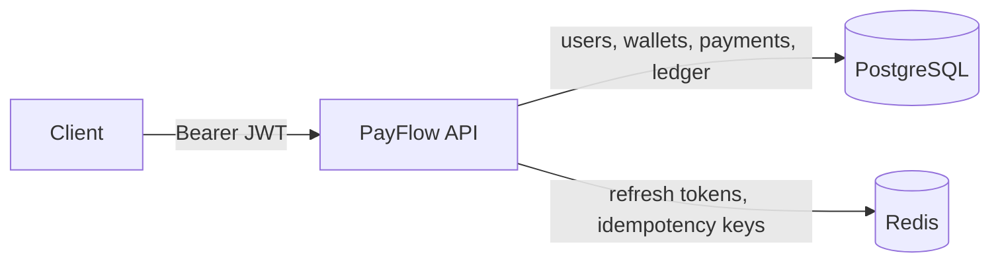

# PayFlow

[](https://github.com/Gupta-19/PayFlow/actions/workflows/ci.yml)

A wallet and payments REST API in Java 21 and Spring Boot 4, with JWT auth, idempotent payments and a double-entry ledger.
Two guarantees drive the design: **a retried request never moves money twice**, and **the ledger always balances**.

## Architecture



All money and the ledger live in PostgreSQL. Redis holds only short-lived keys (refresh tokens, idempotency records), so losing Redis never loses money.

**Stack:** Java 21 · Spring Boot 4.1 (Spring Security 7, Spring Data JPA, Jackson 3) · PostgreSQL 16 + Flyway · Redis 7 · JUnit 5 + Testcontainers · Docker Compose · GitHub Actions

## Run it

Requires Docker. Generate an RSA key pair for signing JWTs (Windows: run these in Git Bash, which bundles `openssl`):

```bash
mkdir -p keys
openssl genpkey -algorithm RSA -pkeyopt rsa_keygen_bits:2048 -out keys/private.pem
openssl rsa -in keys/private.pem -pubout -out keys/public.pem
chmod 644 keys/*.pem              # Linux/macOS: the container runs as a non-root user
docker compose up --build -d
docker compose logs -f app        # wait for "Started PayflowApplication"
```

If port 8080 is taken: `APP_PORT=8081 docker compose up --build -d`. `keys/` is gitignored and mounted read-only into the container; it is never baked into the image.

## API

| Method and path | Auth | Body | Success | Main errors |
|---|---|---|---|---|
| `POST /auth/signup` | – | `email`, `password` | 201 `userId`, `walletId` | 400, 409 |
| `POST /auth/login` | – | `email`, `password` | 200 `accessToken`, `refreshToken`, `expiresIn` | 401 |
| `POST /auth/refresh` | – | `refreshToken` | 200 new token pair | 401 |
| `POST /auth/logout` | Bearer | `refreshToken` | 204 | 401 |
| `GET /wallets/me` | Bearer | – | 200 `walletId`, `balance`, `currency` | 401 |
| `GET /wallets/me/transactions?page=0&size=20` | Bearer | – | 200 ledger entries, newest first | 401 |
| `POST /wallets/me/topup` | Bearer + `Idempotency-Key` | `amount` | 201 payment | 400, 409, 422 |
| `POST /payments` | Bearer + `Idempotency-Key` | `toWalletId`, `amount`, `note?` | 201 payment | 400, 404, 409, 422 |
| `GET /payments/{id}` | Bearer | – | 200 payment | 404 |

All amounts are **integer paise**: `"amount": 25000` is Rs 250.00. Errors are [RFC 9457 Problem Details](https://www.rfc-editor.org/rfc/rfc9457) (`type`, `title`, `status`, `detail`, `instance`; validation errors add an `errors` list).

### Walkthrough

Needs `curl` and [`jq`](https://jqlang.org/). The script uses fixed emails, so run it on a fresh database: on a re-run, signup returns 409. To reset, run `docker compose down -v`, then start the stack again.

```bash
API=localhost:${APP_PORT:-8080}
J='Content-Type: application/json'

# Sign up two users; keep Bob's wallet id
curl -s -X POST $API/auth/signup -H "$J" -d '{"email":"alice@test.com","password":"password123"}' | jq
BOB_WALLET=$(curl -s -X POST $API/auth/signup -H "$J" \
  -d '{"email":"bob@test.com","password":"password123"}' | jq -r .walletId)

# Log in as Alice
TOKEN=$(curl -s -X POST $API/auth/login -H "$J" \
  -d '{"email":"alice@test.com","password":"password123"}' | jq -r .accessToken)
AUTH="Authorization: Bearer $TOKEN"

# Top up Rs 500
curl -s -X POST $API/wallets/me/topup -H "$AUTH" -H "$J" -H 'Idempotency-Key: topup-1' \
  -d '{"amount":50000}' | jq

# Pay Bob Rs 25, then send the exact same request again
curl -si -X POST $API/payments -H "$AUTH" -H "$J" -H 'Idempotency-Key: pay-1' \
  -d "{\"toWalletId\":\"$BOB_WALLET\",\"amount\":2500,\"note\":\"lunch\"}"; echo
curl -si -X POST $API/payments -H "$AUTH" -H "$J" -H 'Idempotency-Key: pay-1' \
  -d "{\"toWalletId\":\"$BOB_WALLET\",\"amount\":2500,\"note\":\"lunch\"}"; echo
# -> second response: same payment id, header "Idempotent-Replayed: true", money moved once

curl -s $API/wallets/me -H "$AUTH" | jq                # balance 47500
curl -s $API/wallets/me/transactions -H "$AUTH" | jq   # newest first: DEBIT 2500, then CREDIT 50000
```

## Design decisions

**RS256 JWT with rotating, hashed refresh tokens.** Access tokens are 15-minute RS256 JWTs checked by signature, issuer and expiry, with no database lookup per request. Refresh tokens are 32 random bytes valid for 7 days. Only their SHA-256 hash is stored in Redis, so a Redis dump can't be used to log in. Each refresh does an atomic `GETDEL`, so a refresh token works exactly once and every refresh hands out a new one. Logout deletes it.

**Idempotency in Redis, with a database backstop.** Money endpoints require an `Idempotency-Key`. The key is claimed with `SET NX` (60 s while in progress, 24 h once completed), scoped per user, and tied to a SHA-256 of path + body. A repeat returns the stored response with `Idempotent-Replayed: true`. The same key with a different body gets 422, and one still in flight gets 409. If Redis loses the key, the `UNIQUE (created_by, idempotency_key)` constraint stops a second insert and the original payment is returned. Its type, recipient and amount must match the retry, otherwise the response is 422.

**Double-entry ledger with a SYSTEM wallet.** Every payment writes exactly one DEBIT and one CREDIT of the same amount. Top-ups are transfers from a SYSTEM wallet that is allowed to go negative, so the sum of all balances is always 0 and every balance equals its credits minus its debits. `LedgerService.move()` is the only code that changes a balance.

**Pessimistic row locks in a fixed order.** `move()` takes `SELECT ... FOR UPDATE` on both wallets, always locking the smaller UUID first, so opposite transfers (A→B and B→A) can't deadlock. Pessimistic locking was chosen over optimistic versioning because contention on a hot wallet would otherwise turn into retry storms. The lock also makes the balance check and the debit atomic.

**Money as integer paise.** Amounts are `long` paise in Java and `BIGINT` in Postgres, so there is no floating-point rounding. Jackson's `accept-float-as-int` is turned off, so `{"amount": 100.5}` is a 400 rather than being silently truncated. Each payment is capped by `app.payments.max-amount`.

**JVM pinned to UTC.** On a machine set to India Standard Time the JVM reports the legacy zone `Asia/Calcutta`, which pgjdbc sends to Postgres on connect and Postgres 16 rejects. `main()` and the Surefire `argLine` set UTC, and all timestamps are `Instant`/`TIMESTAMPTZ`.

## Testing

```bash
./mvnw verify     # needs Docker: Postgres and Redis run in Testcontainers
```

19 tests (18 drive the real API over HTTP, plus a context-load test) run against real Postgres and Redis, with no mocks of our own classes:

- **Concurrency:**
  - 20 parallel Rs 10 payments from a Rs 100 wallet: exactly 10 succeed, 10 get 422, and the balance ends at 0.
  - 50 rounds of A→B and B→A in parallel all finish within 30 s with no deadlock.
- **Idempotency:**
  - A repeated payment is charged once and returns the same id.
  - The same key with a different body gets 422.
  - A rejected payment replays the same 422.
  - With the Redis key deleted, the database backstop returns the original payment.
- **Ledger invariant:** after every test, an `@AfterEach` check asserts that all balances sum to 0 and that every wallet's balance equals its ledger.

**Mutation check:** in our run with `@Lock(PESSIMISTIC_WRITE)` removed, all 20 payments succeeded (lost updates), and both concurrency tests plus the ledger check failed. The exact count depends on timing. With the lock restored, everything passes.

CI (`.github/workflows/ci.yml`) runs `./mvnw -B verify` and builds the Docker image on every push and pull request.

## Known limitations and what I'd add next

- **Transactional outbox** for `payment.completed` events and webhooks, so events are published reliably after commit.
- **SYSTEM wallet is a hot row:** every top-up locks it, so top-ups are serialized. Sharding it into several system wallets would fix this.
- **Business errors are cached for 24 h** under their idempotency key, so a client that fixes the cause (for example by adding funds) must use a new key.
- **Redis outage fails closed:** money endpoints return 500 rather than risk a double charge.
- **Idempotency keys are shared per user** across top-ups and payments.
- **After a 500 the idempotency key is deleted unconditionally.** Suppose the 60 s IN_PROGRESS claim had already expired and another request claimed the key again. That newer claim is then dropped too. The database constraint still prevents a double charge.
- **Login timing reveals whether an email exists:** BCrypt only runs for known emails. A fix is to compare against a dummy hash for unknown emails.
- **No rate limiting** on login and signup yet.
- **`/actuator/prometheus` is public;** it should be restricted to the internal network in production.
- **No Kubernetes manifests** (Deployment, Service, probes on `/actuator/health`).
